# 逆水小助手 · 需求文档（流程图版）

> 版本：v1.0 · 2026-10-28
> 配套文档：[功能需求清单](功能需求清单.md) · [原型总结](原型总结.md) · [选型总结](选型总结.md)
> 本文档以流程图表达全部业务逻辑，文字仅作补充说明。

---

## 1. 产品概述

| 项 | 内容 |
|---|---|
| 定位 | 逆水侠棋 · 赛前备课 / 局间快查 / 赛后复盘工具（非官方） |
| 平台 | 微信小程序（原生 + 云开发） |
| 架构 | 通用内核 + 游戏内容包（可复用到其他自走棋） |
| 核心 | 5 Tab：首页 / 阵容 / 摆棋 / 图鉴 / 我的；一切数据以「赛季」为维度 |
| 变现 | 信息流 banner 广告位预留（后台开关） |

## 2. 全局导航

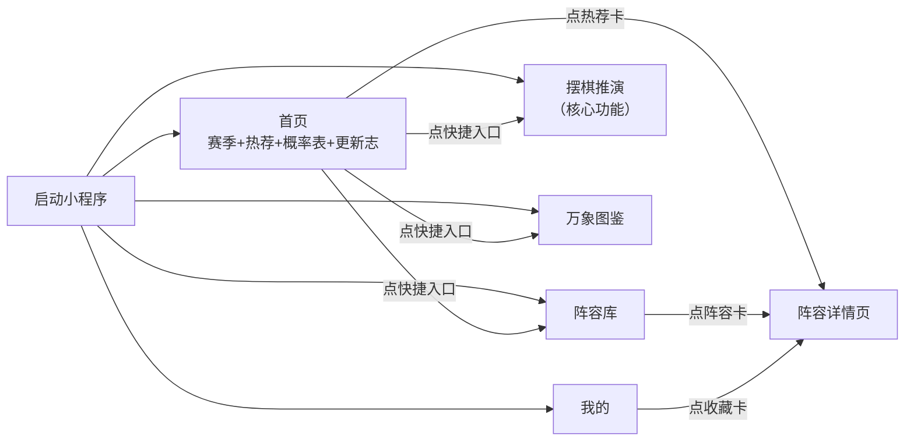

## 3. 赛季体系（贯穿全站）

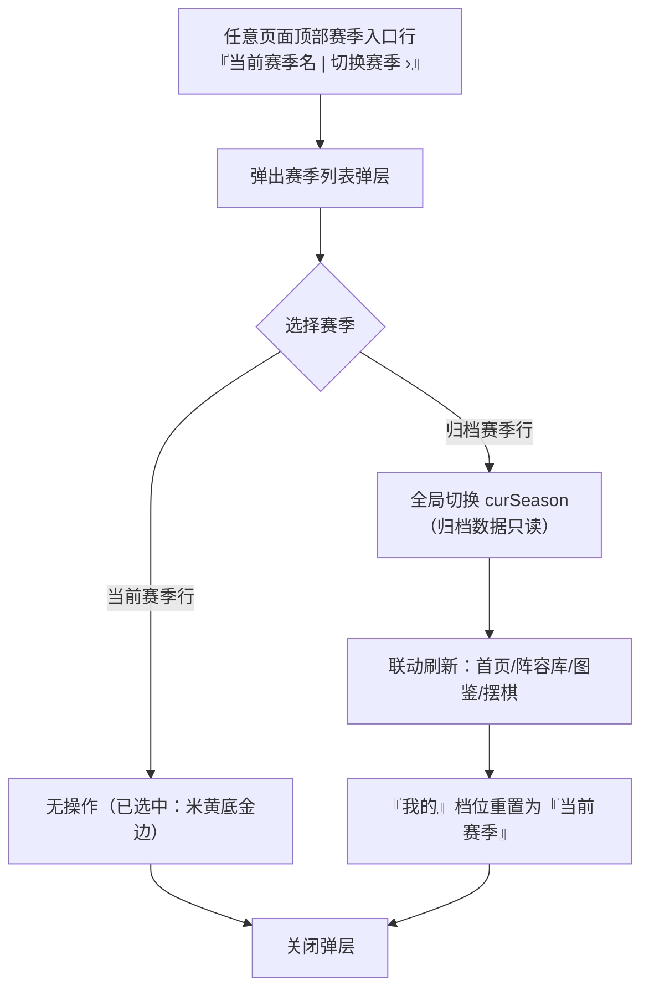

**规则**：所有数据集合读写自动注入 `season` 字段；赛季更替时旧数据归档不删除，弹层可随时切回查看。

## 4. 阵容库（阵容推荐）

```mermaid
flowchart TD
    List["阵容库列表"] --> Bar["工具条：排序 + 筛选"]
    Bar --> Sort{"排序"}
    Sort --> S1["强度（S>A>B，同级按热度）"]
    Sort --> S2["热度"]
    Sort --> S3["口碑（赞−踩 净分）"]
    Sort --> S4["最新（更新日期）"]
    Bar --> Filter{"筛选"}
    Filter --> F1["全部"]
    Filter --> F2["彩色羁绊 ✦"]
    Filter --> F3["84阵容（8人口4费C）"]
    Filter --> F4["95阵容（9人口5费C）"]
    List --> Card["点阵容卡"]
    Card --> Detail["详情页：站位图/羁绊/装备/心悟/运营节奏/四列数据"]
    Detail --> Fav{"点 ☆"}
    Fav -->|"未收藏"| FavOn["写入收藏（记当前赛季）→ toast"]
    Fav -->|"已收藏"| FavOff["取消收藏 → toast"]
    Detail --> Share["生成分享卡片 → 底部弹层预览 → 保存图片分享"]
    Detail -->|"空态"| Empty["『此筛选下暂无阵容』"]
```

### 4.1 点赞/踩 状态机（单人一票制）

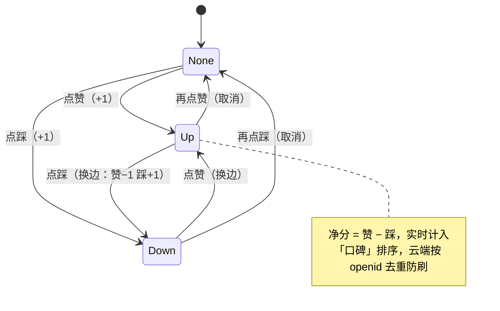

## 5. 摆棋推演（核心模块）

### 5.1 棋盘交互总路由

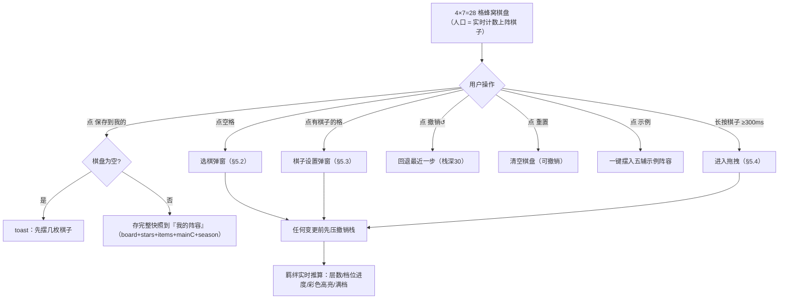

### 5.2 选棋弹窗（点空格）

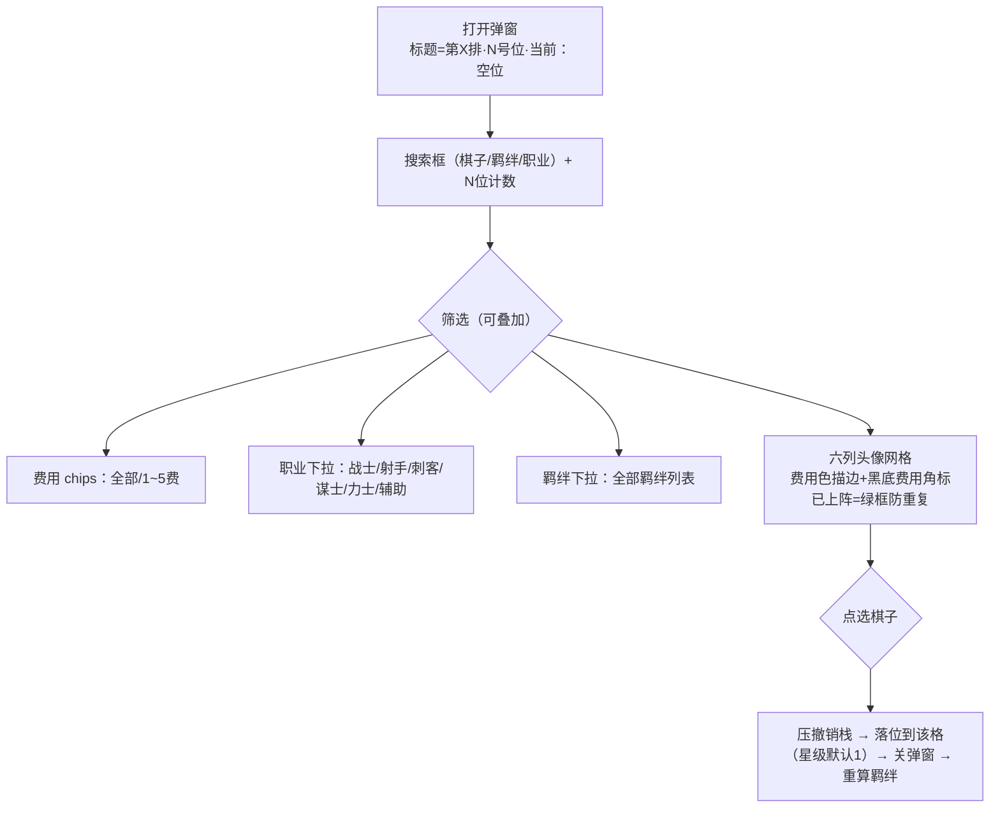

### 5.3 棋子设置弹窗（点棋子）

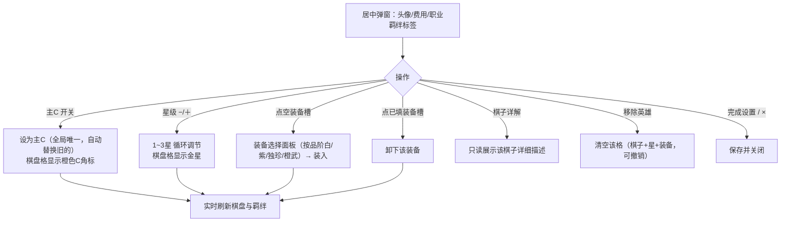

### 5.4 长按拖拽（移除 / 换位）

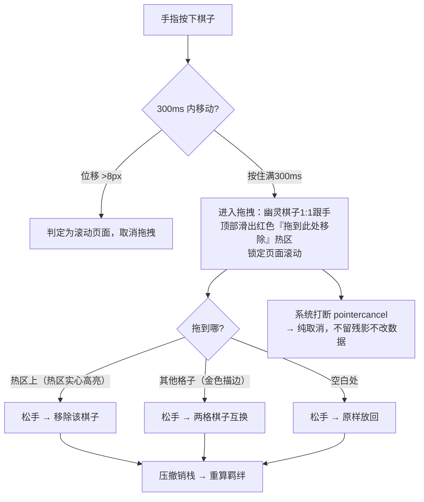

## 6. 万象图鉴

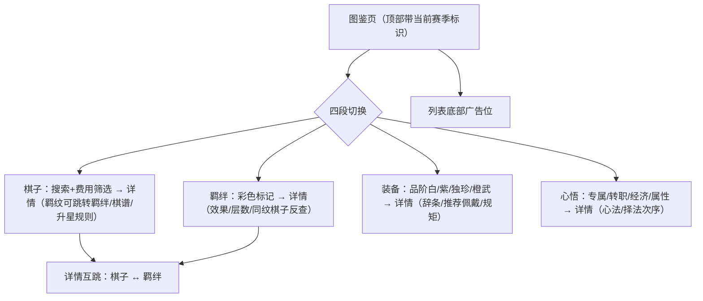

## 7. 我的

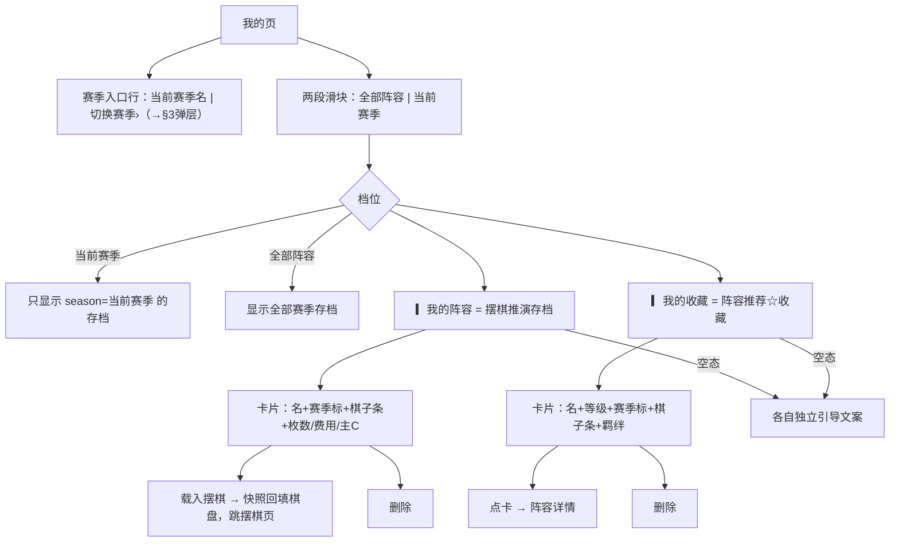

## 8. 云端数据流（正式版）

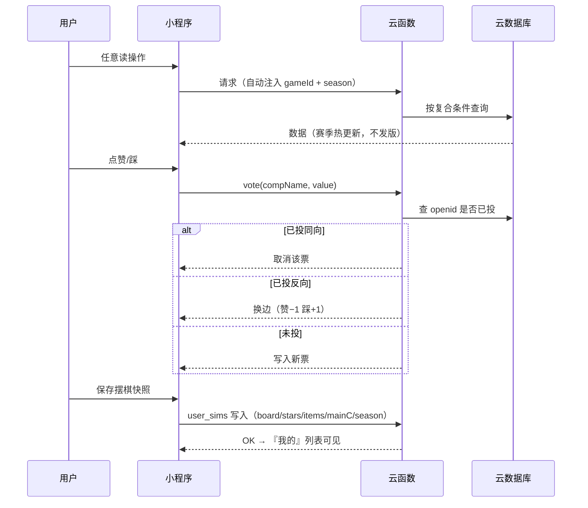

## 9. 数据集合（9 个，全部带 `season`）

```mermaid
flowchart LR
    subgraph 内容包 games/gameId/data（赛季维度）
        pieces["棋子 pieces<br/>cost/job/bonds/note"]
        bonds["羁绊 bonds<br/>tiers/color"]
        equips["装备 equipments<br/>rarity/who"]
        augments["心悟 augments<br/>专属/转职/经济/属性"]
        comps["阵容 comps<br/>traits/站位/stats/beats"]
        notes["更新志 patch_notes"]
    end
    subgraph 用户数据
        sims["user_sims 摆棋快照"]
        favs["user_favs 收藏"]
        votes["votes 赞踩（openid去重）"]
    end
    comps -->|"引用"| pieces
    comps --> bonds
```

## 10. 非功能需求

| 类 | 要求 |
|---|---|
| 合规 | 名称备选「侠棋小助手」防审驳回；全站非官方免责声明；零游戏立绘（印章字头像） |
| 性能 | 数据全云端热更新；图片懒加载；动画仅 transform/opacity |
| 可复用 | 组件/页面禁止游戏专名，文案走 pack.terms；换游戏=换内容包 |
| 降级 | 减弱动效模式下移除装饰动效、保留终态；离线只读缓存最近赛季数据 |
